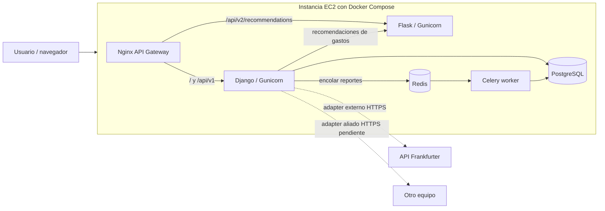

# FinanSmart — Entregable 2, bloque de Samuel

> Estado: implementación preparada para integrar y verificar en el repositorio. **No afirma despliegue AWS ni conexión real con un equipo aliado.** La compra premium es una simulación académica, sin pasarela ni dinero real.

## Alcance técnico

- `premium.PremiumPlan`: catálogo editable por administradores, monto de demostración en COP, vigencia y disponibilidad.
- `premium.Payment`: registro individual y auditable de una simulación aprobada o rechazada, referencia UUID, importe y vigencia para un usuario. Un rechazo no activa beneficios; una aprobación posterior extiende la vigencia.
- `premium.ReportJob`: solicitud de reporte mensual con estado en cola, ejecutándose, completado o fallido. Celery usa Redis como broker; el worker calcula datos del usuario dueño de la solicitud.
- `expenses.infra.remote_recommendations.RemoteRecommendationEngine`: motor remoto invocado por Django para registrar gastos. Factory permite `MOCK`, `REAL` y `REMOTE`; en Compose se selecciona `REMOTE`. Un timeout de 3 s activa recomendación local de respaldo.
- Flask expone `POST /api/v2/recommendations/` y `GET /health/`. Acepta `language` y usa catálogos gettext para mensajes ES/EN.
- Docker Compose incluye PostgreSQL, Redis, Celery, Django/Gunicorn, Flask/Gunicorn y Nginx.
- Las páginas `/premium/` y `/premium/reportes/` requieren inicio de sesión; CSRF de Django protege los formularios. El historial de pagos y reportes se limita al usuario autenticado.

## Diagrama de despliegue (Mermaid)



La flecha de equipo aliado es **pendiente**, no un enlace probado. AWS es el destino de despliegue exigido, no un despliegue ya realizado.

## Puesta en marcha local desde la rama de Yohn

1. Trabajar en rama propia creada desde `origin/entrega2-yohn-frontend`, verificando identidad de GitHub **Sserna12**.
2. Ejecutar el instalador suministrado **solo con el árbol limpio y la rama correcta**, desde la raíz del repositorio.
3. Crear `.env` desde `.env.example` solo si no existe. Reemplazar `DJANGO_SECRET_KEY` por `python -c "import secrets; print(secrets.token_urlsafe(48))"` y `DB_PASSWORD` por una contraseña fuerte; nunca subir `.env`.
4. Validar archivos: `docker compose config`, luego `docker compose up --build -d` y `docker compose ps`.
5. Crear un usuario para la demostración: `docker compose exec django_web python manage.py createsuperuser`.
6. Abrir `http://localhost:8080/` (o puerto definido en `HTTP_PORT`); entrar, crear presupuesto, gasto y comprobar recomendación.
7. Abrir `/premium/`, simular aprobación y rechazo; abrir `/premium/reportes/`, solicitar reporte y actualizar para ver el resultado.
8. Verificar `docker compose logs --tail=150 django_web celery_worker recommendation_service nginx`.

## Pruebas

Con virtualenv y dependencias instaladas, sin Docker:

```bash
python manage.py check
python manage.py makemigrations --check --dry-run
python manage.py test expenses finance premium
```

Para la validación de Flask dentro de Compose:

```bash
docker compose exec recommendation_service python -c "from app import app; c=app.test_client(); print(c.post('/api/v2/recommendations/', json={'category_name':'Comida','spent':'70','limit':'100','language':'en'}).json)"
```

Para la verificación de tareas:

```bash
docker compose logs --tail=80 celery_worker
```

Probar deteniendo `recommendation_service` para ver fallback. **Cuidado:** `docker compose stop recommendation_service` deja Nginx con upstream detenido para las llamadas directas a la API v2, pero las rutas de Django deberían seguir funcionando si ya está iniciado. Volver a encender con `docker compose start recommendation_service`.

## AWS Academy — tareas operativas pendientes

- Iniciar EC2 (Linux x86_64 compatible con Docker), configurar disco y recursos suficientes; instalar Docker Engine/Compose.
- Proteger SSH limitándolo a IPs autorizadas. Abrir en Security Group solo el puerto HTTP elegido (`8080` por defecto) y, para la versión final con HTTPS, el puerto `443`. Nunca exponer Redis (6379), Postgres (5432) ni el Flask interno (5000).
- Configurar la IP elástica y definir `ALLOWED_HOSTS=IP_ELASTICA,localhost,django_web` en `.env`; configurar dominio, terminación TLS y `CSRF_TRUSTED_ORIGINS` cuando se disponga de HTTPS. Un sitio académico con autenticación **no debe exponerse públicamente con credenciales o tokens sobre HTTP**; para la sustentación usar red controlada o HTTPS.
- Habilitar un proxy TLS/certificado para el servicio externo: `nginx.conf` incluido es HTTP **sin HTTPS por sí mismo**. No presentar el servicio como protegido por TLS hasta configurarlo y comprobarlo.
- Llevar el repositorio integrado en `main`, configurar secretos, ejecutar `docker compose up --build -d` en EC2 y comprobar desde un equipo externo: `/`, `/api/v1/summary/` autenticado, `/api/v2/recommendations/`, `/premium/` y `/premium/reportes/`.
- Dejar instancia encendida al sustentar, con IP elástica entregada. Documentar capturas, salida de `docker compose ps`, logs sin secretos, respuesta JSON y pruebas de falla.
- Conseguir URL, autenticación y contrato JSON de **otro equipo** para `ALLY_API_URL` y adaptar `AllyAdapter` al contrato real. El adaptador actual no demuestra integración.
- Confirmar con el profesor y en la sustentación las correcciones completas de Entrega 1: son requisito eliminatorio.

## Riesgos y límites

- Precio `19.900 COP` del plan inicial: **solo un dato ilustrativo de prueba**, configurable en `/admin/`; no es precio real o exigencia del profesor.
- El pago aprobado es una simulación de aplicación; **no** se valida una transacción financiera ni se conecta una pasarela.
- Celery y Redis deben verificarse en la máquina real; cuando Redis falla el reporte aparece como fallido. No hay reintentos automáticos del reporte.
- No se verificó la infraestructura en AWS, ni se conectó un equipo aliado. No se reclama el bono del 70 % de negocio migrado a microservicios por tener 7 clases: son cálculos distintos.
- Los catálogos gettext de la nueva app y el microservicio están incluidos; revisar exhaustivamente cualquier pantalla nueva de Yohn al integrar.
- Antes de subir a `main`, ejecutar el conjunto de pruebas, validar ambiente seguro, revisar diff con Yohn y sustentar lo que realmente se completó.
